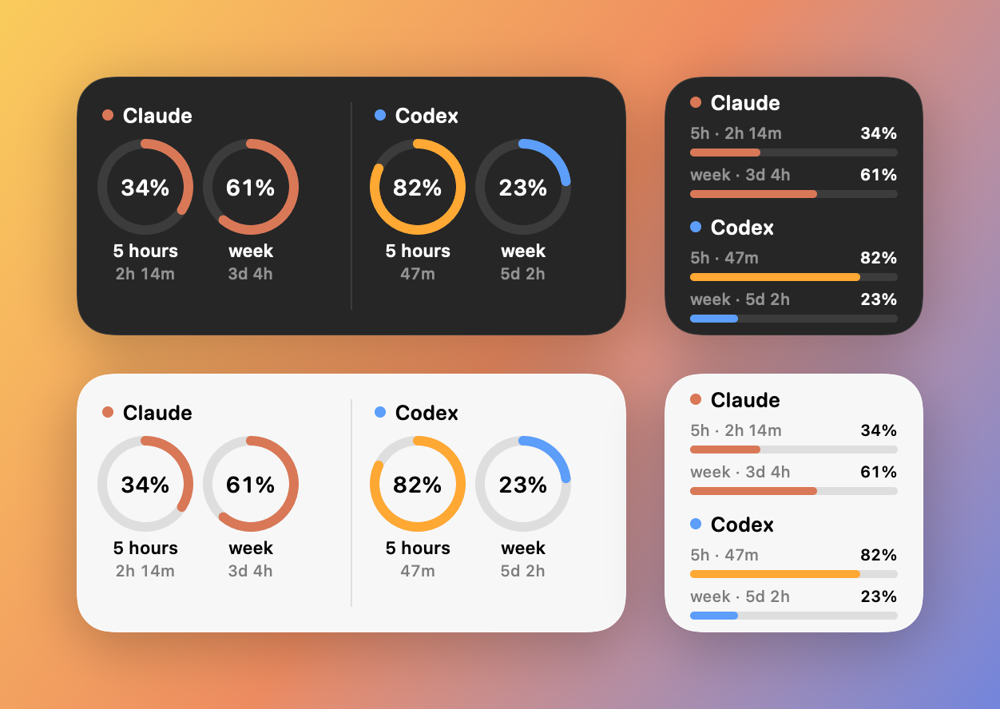
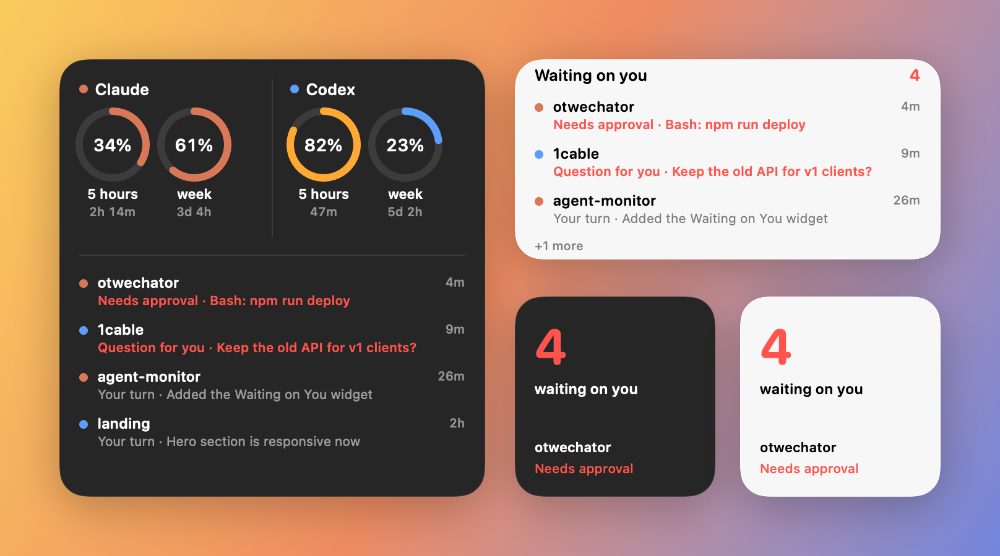

<p align="center">
  
</p>

<h1 align="center">Agent Monitor</h1>

<p align="center">
  Native macOS desktop widgets for <b>Claude Code</b> and <b>Codex</b>:<br>
  usage limits (5-hour and weekly) and which agents are <b>waiting on you</b>.
</p>

<p align="center">
  
  
  
</p>

<p align="center">
  
</p>

---

## Why

Claude Code and Codex both meter you on two windows: a rolling **5-hour** limit and a **weekly** one. Hitting either mid-task is annoying, and checking means running a slash command or opening a settings page.

And when you run several agents at once, they quietly stall: one wants approval for a command, another asked a question, a third finished ten minutes ago. Agent Monitor shows both things at a glance: how much of your limits is left, and where work is stuck on you.

## Features

### Waiting on you

<p align="center">
  
</p>

- **Blockers first, in red.** A session shows here when it needs approval for a tool call, asked you a question, or has a plan for you to review.
- **Finished turns below.** Sessions that completed a turn and are waiting for your next prompt. They hide after 6 hours.
- **Real time in the menu bar.** The icon shows a count (red when something is blocked). Click a session to jump to the app it runs in: Terminal, iTerm, Ghostty, Claude, Codex, VS Code…
- **Works across surfaces.** Terminal sessions and desktop apps alike, via the agents' official hooks.
- **Dead sessions clean themselves up.** On session end, or when the agent process is gone.

### Usage limits

- **Real WidgetKit widget.** It lives in the widget gallery and snaps to the desktop grid like Weather or Calendar.
- **Three sizes.** Medium shows four rings, small shows compact bars, large adds the waiting list.
- **Countdowns.** Time until each window resets, updated every minute.
- **Color warnings.** Each ring turns amber at 75% and red at 90%.
- **Light and dark.** Follows the system appearance.
- **Menu bar companion.** Shows the current numbers and offers *Refresh*, *Launch at Login* and *Quit*.
- **Zero config.** Reuses the logins you already have in Claude Code and Codex CLI.

## Install

**Requirements:** macOS 14 Sonoma or later, Xcode 15 or later (free from the App Store), and Claude Code and/or Codex CLI signed in on this Mac.

> Xcode is needed because WidgetKit extensions can't be built with the Command Line Tools alone. You don't need an Apple Developer account: the app is signed locally ("Sign to Run Locally").

```bash
git clone https://github.com/paveler/agent-monitor.git
cd agent-monitor
./scripts/install.sh
```

The script builds the app, copies it to `/Applications` and launches it. You'll see a gauge icon in the menu bar.

Then:

1. **Add the widget.** Right-click the desktop → **Edit Widgets…** → search **Agent Monitor** → drag the medium or small widget onto the desktop.
2. **Allow Keychain access.** On first launch macOS asks to let Agent Monitor read `Claude Code-credentials`. Click **Always Allow**.
3. **Connect your agents** (for *Waiting on you*). Click the menu bar icon → **Integrations** → **Connect Claude Code…** and/or **Connect Codex…**
   - This adds hooks to `~/.claude/settings.json` / `~/.codex/hooks.json`. Your existing hooks stay, and a backup is saved next to the file.
   - **Codex** asks you to trust new hooks once: run `/hooks` in Codex CLI, or open **Settings → Hooks** in the Codex app.
   - Restart running sessions so they pick up the hooks.
4. **Turn on Launch at Login** in the menu bar icon. The widgets show data the app collects, so keep the app running.

### Updating

```bash
git pull && ./scripts/install.sh
```

### Uninstalling

Disconnect the agents in **Integrations** (this removes only Agent Monitor's hooks), quit from the menu bar icon, remove the widgets from the desktop, then:

```bash
rm -rf /Applications/AgentMonitor.app ~/Library/Application\ Support/AgentMonitor
```

## How it works

```
┌──────────────────────┐   every 2 min   ┌──────────────────────────────┐
│  Menu bar app        │ ──────────────▶ │ ~/Library/Application Support│
│  (not sandboxed)     │   snapshot.json │   /AgentMonitor/             │
│                      │                 └──────────────┬───────────────┘
│  • Claude: Keychain  │                                │ read-only
│    → Anthropic API   │   reloadTimelines              ▼
│  • Codex: ~/.codex   │ ──────────────▶  ┌──────────────────────────┐
│    → ChatGPT API     │                  │ WidgetKit extension      │
│    (fallback: logs)  │                  │ (sandboxed)              │
└──────────────────────┘                  └──────────────────────────┘
```

| Agent  | Where the credentials come from                         | Where the usage comes from |
|--------|---------------------------------------------------------|----------------------------|
| Claude | Claude Code's OAuth token in the macOS Keychain          | `api.anthropic.com/api/oauth/usage` |
| Codex  | Codex CLI's token in `~/.codex/auth.json`                | `chatgpt.com/backend-api/wham/usage`, falling back to the latest `rate_limits` event in `~/.codex/sessions` |

Widgets are sandboxed and can't read the Keychain or `~/.codex`. So a small menu bar app does the fetching, writes a JSON snapshot, and the widget only has read access to that one folder.

### Waiting on you

Both agents support lifecycle hooks with nearly the same events. The installed hook runs Agent Monitor's own binary (`AgentMonitor --hook claude|codex`). It reads the event, updates a tiny per-session file in `~/Library/Application Support/AgentMonitor/sessions/`, prints nothing and exits 0, so it never changes the agent's behavior. The menu bar app watches that folder and updates instantly.

| Event | State |
|---|---|
| `PermissionRequest`, Claude `Notification: permission_prompt` | **Needs approval** |
| Claude `AskUserQuestion`, `elicitation_dialog` | **Question for you** |
| Claude `ExitPlanMode` | **Plan to review** |
| `Stop` (nothing running in the background) | **Your turn** |
| `UserPromptSubmit`, `PostToolUse` | working (hidden) |
| `SessionEnd`, or the agent process exited | removed |

## Privacy

- Your tokens never leave your Mac, except to the same Anthropic and OpenAI endpoints the official CLIs already talk to.
- There's no analytics, no telemetry and no third-party servers.
- The snapshot file contains only percentages and reset times. Session files contain the project folder, the session title, and a one-line summary of what's pending.

## Caveats

- **Both usage endpoints are undocumented.** They're what the official tools use internally, and they can change without notice. If a number disappears after an update, please open an issue.
- **Claude tokens expire.** Claude Code refreshes its token when you use it. If the widget says *Token expired*, open Claude Code once.
- **Widgets lag; the menu bar doesn't.** macOS limits how often widgets redraw, roughly every 15–30 minutes for an app in the background. The menu bar count is live; treat the widget as an overview.
- **Jumping goes to the app, not the exact tab.** Clicking a session activates the terminal or app that runs it.
- **The Codex fallback can be stale.** When the API isn't reachable, the numbers come from your last Codex session. A window that has already reset is shown as 0%.

## Troubleshooting

| Symptom | Fix |
|---|---|
| Nothing shows in *Waiting on you* | Check **Integrations** shows the agent as connected. Restart running sessions. For Codex, trust the hooks via `/hooks` or Settings → Hooks. |
| Widget says **No data yet** | Click the menu bar icon: do numbers show there? If yes, remove the widget and add it again (macOS caches old builds). |
| **Not signed in to Claude Code** | Run `claude` and log in, then click **Refresh**. |
| No Keychain prompt and no Claude data | Open **Keychain Access**, find `Claude Code-credentials`, and allow Agent Monitor under **Access Control**. |
| Widget doesn't appear in the gallery | Make sure the app is in `/Applications` and has been launched once. Then log out and back in. |
| Build fails with *requires Xcode* | Run `sudo xcode-select -s /Applications/Xcode.app/Contents/Developer`. |

## Development

```
App/      menu bar app: fetching, hooks handler and installer, menu
Widget/   WidgetKit extensions: timeline providers and SwiftUI views
Shared/   models, snapshot and session stores, app icon assets
tools/    icon generator and README preview renderer
```

- The project is described in [`project.yml`](project.yml) ([XcodeGen](https://github.com/yonaskolb/XcodeGen)). The generated `AgentMonitor.xcodeproj` is committed, so XcodeGen is optional.
- Regenerate the icon: `swift tools/make_icon.swift icon.png`.
- Re-render the README images from the real widget views: `tools/render-previews.sh`.

PRs welcome. Ideas on the list: notifications near the limit, usage history sparkline, jumping to the exact terminal tab, and more agents (Gemini CLI, Cursor).

## License

[MIT](LICENSE). Not affiliated with Anthropic or OpenAI. Claude and Codex are trademarks of their respective owners.
